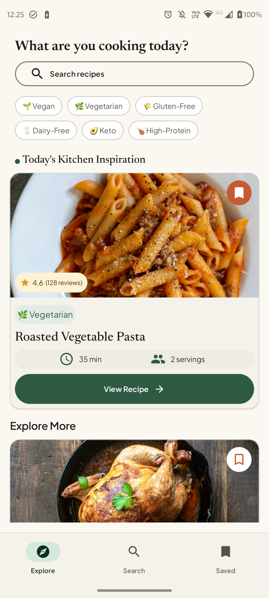
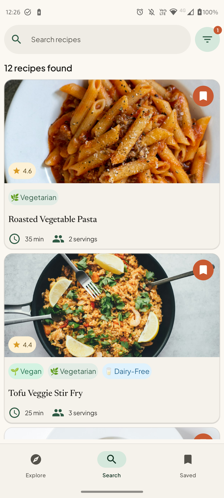
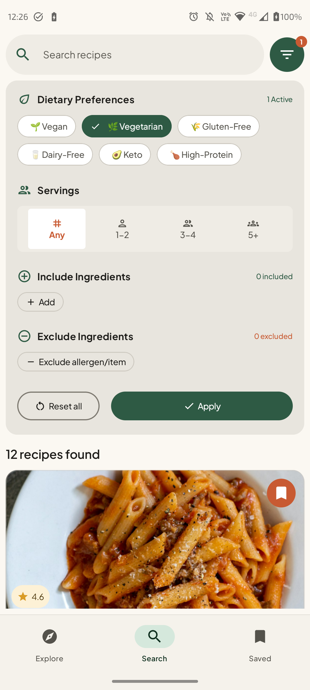
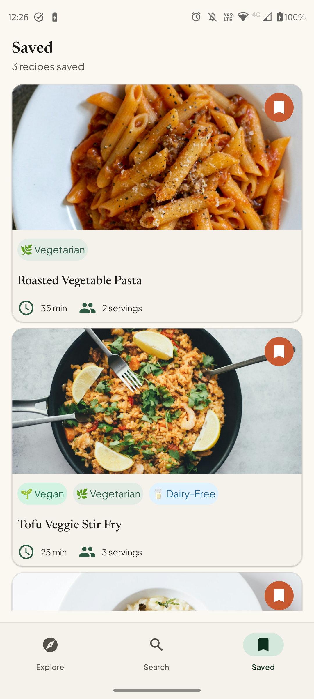
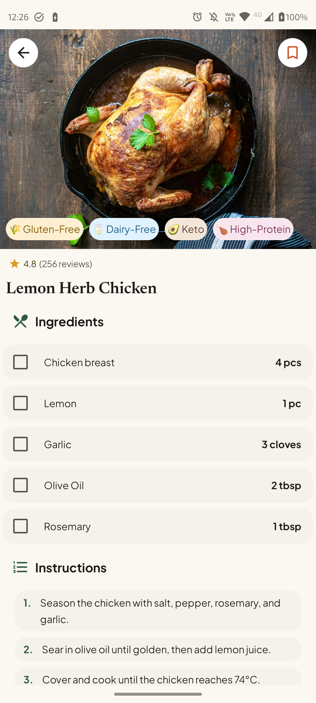

<div align="center"> 
<br></br>
<h1>Search Recipes Challenge</h1> 
<p>Solution for the <a href="https://recime.notion.site/ReciMe-Android-Coding-Challenge-3fe720b31dfb81219dccc7ca14b5e8d5#5c0b46652e3047019a5e6917d7305c72">ReciMe Android Challenge</a></p> 
</div>


## 📱 The challenge

Create an app that allows users to browse and search a collection of cooking recipes.

## 🏗 Layers
The project divides the layers into folders (for a bigger project this folders would be modules)

- **core**

    - **data** models, repositories, network and local-storage.
    - **ui** theme and shared preview data.
    - **components** shared Compose components.
    - **navigation** app destinations.

- **features** Screen UIs, ViewModels, Koin modules for each feature.
    - **explore**
    - **search**
    - **recipe_details**
    - **saved**

### DataFlow
```
[UI] <--> [ViewModel] <--> [Repository] <--> [API/Database]
```
*API and Database are Faked with a local json file*

## 🔧 Technologies and tools
- **Jetpack Compose** to build the UI
- **Koin** for dependency injection
- **Unit Tests** for the ViewModels
- **Kotlin Flows** for reactiveness
- **MVVM** architecture

## 📽️ Screenshots

|Explore|Search|Search filters|Saved|Recipe Details|
|---|---|---|---|---|
||||||


&nbsp;

## 🏁 Getting Started

Clone the repo and open in Android Studio (preferably Coil or later versions)

Crafted with ❤️ and Kotlin.
